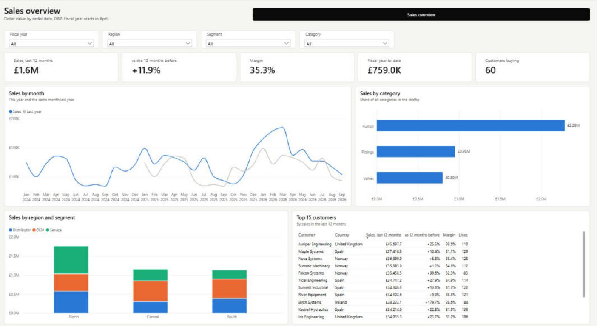

# Power BI Autopilot

Claude Code skills that do the Power BI work for you. Point Claude at a folder of spreadsheets or a `.pbix` and it builds the model, builds the report pages in Power BI Desktop, explains what is there, reviews every DAX measure, and checks its own work on screen and against the source data.

They are written for people who have never opened a TMDL or PBIR file and don't want to. Claude picks the file format, converts what needs converting, drives Power BI Desktop, and asks you only what it can't work out: what the report is for, which numbers matter, and whether something may be deleted.



*Built end to end by `/model-it` and `/viz-it` from two CSV files and an Excel sheet (the [Acme sample](examples/acme-sales)); the headline numbers were checked against the raw data.*

| Command | What it does |
|---|---|
| `/init-pbi` | Gets a folder ready: finds every report and model, checks Power BI Desktop, Node and the Power BI MCP (installs the MCP if missing), sets up git hygiene, writes a Power BI section into `CLAUDE.md`, tidies the existing notes, and asks you for the business context it can't see. |
| `/model-it` | Builds the model from raw data: profiles Excel, CSV or SQL sources, designs a star schema, creates the project if there isn't one, writes tables, Power Query, a date table (fiscal year included), relationships and measures, then refreshes in Desktop and checks row counts and totals against the source. |
| `/viz-it` | Builds report pages end to end. Converts a `.pbix` to a project, reads the model, adds missing measures, generates the pages, opens them in Desktop, screenshots every page and fixes what looks wrong. |
| `/data-who` | Explains a dashboard: one paragraph on what it is for and how to read it, then page by page, visual by visual, every number defined from its DAX, where the data comes from, and the traps. |
| `/audit-measures` | Reviews every measure: broken references, unused and duplicate measures, risky DAX patterns, formats, descriptions, and a read of each measure's logic against its name. Then asks which fixes to apply. |
| `/mcp-it` | Installs Microsoft's [Power BI Modeling MCP](https://github.com/microsoft/powerbi-modeling-mcp) for every project, so Claude can read and edit models live in Desktop or the service. |

## Install

**As a plugin** (commands are prefixed: `/pbi:viz-it`, `/pbi:data-who`, ...):

```
claude plugin marketplace add seanmcmahon101/power-bi-autopilot
claude plugin install pbi@power-bi-autopilot
```

Inside a session the same works as `/plugin marketplace add seanmcmahon101/power-bi-autopilot`, then `/plugin install pbi@power-bi-autopilot`. Get updates with `claude plugin update pbi@power-bi-autopilot`, or turn on auto-update for the marketplace under **Marketplaces** in `/plugin`.

No SSH key set up for GitHub? Set `CLAUDE_CODE_PLUGIN_PREFER_HTTPS=1` in your environment first, or installs and updates from inside a session fail.

**As personal skills** (plain `/viz-it`, `/data-who`, ...):

```
git clone https://github.com/seanmcmahon101/power-bi-autopilot.git
powershell -ExecutionPolicy Bypass -File power-bi-autopilot\install.ps1
```

Run `install.ps1` again after a `git pull` to update, or with `-Link` to work on the skills in place.

## Getting started

1. Open Claude Code in the folder that holds your Power BI files.
2. Run `/init-pbi`. Answer its few questions.
3. Then whichever you need:
   - `/model-it` when all you have is data ("turn these spreadsheets into a sales model")
   - `/viz-it` for new pages ("a page for the sales team: sales by region and month, top customers")
   - `/data-who` to understand a report someone handed you
   - `/audit-measures` before you trust, publish or hand over a model

To see the whole thing without your own data, build the [Acme sample](examples/acme-sales) (three commands, then Refresh in Desktop).

## Requirements

- Windows with [Power BI Desktop](https://aka.ms/pbidesktopstore) (Store or installer version)
- [Claude Code](https://claude.com/claude-code); the desktop app's computer use lets Claude open and check pages in Power BI Desktop
- Node.js 18 or later for the scripts (`winget install OpenJS.NodeJS.LTS`)
- Optional but recommended: the Power BI Modeling MCP, installed by `/mcp-it`

## How it works

Power BI saves a project (`.pbip`) as plain text: the report as one JSON file per page and visual (PBIR), the model as one text file per table (TMDL). The skills work on those files with a few small, dependency-free scripts, and use Power BI Desktop for anything that needs it: converting a `.pbix`, loading data, and showing the result.

```
/model-it
  profile the data ─ design the star ─ create the project ─ write _model/build.js ─ generate TMDL
                   ─ open in Desktop ─ refresh ─ check row counts and totals against the source
/viz-it
  find ─ convert .pbix to .pbip ─ read the model ─ plan pages ─ add measures
       ─ write _viz/build.js ─ check files ─ load in Desktop ─ screenshot every page ─ fix ─ save
```

Both leave a build script in the project (`_model/build.js`, `_viz/build.js`), so the model and the pages can be changed and rebuilt in seconds, and reviewed like code.

| Script | Purpose |
|---|---|
| `pbi-core/scripts/scan.js` | Inventory of a folder, `.pbip` or `.pbix`: formats, sources, tables, columns, measures with DAX, relationships, pages, visuals, and which fields each visual uses. Reads PBIR inside newer `.pbix` files and the legacy layout of older ones. |
| `pbi-core/scripts/check.js` | Pre-flight for a report before Desktop opens it: invalid JSON, page and visual names, page order, fields missing from the model, visual types that don't exist, known-bad settings, overlaps. |
| `pbi-core/scripts/desktop.ps1` | Finds the Desktop install, opens a file and waits for it, brings a window forward, closes it. |
| `model-it/scripts/profile.js` | Profiles CSV and Excel files: types, blanks, keys, ranges, fact or dimension, and the joins between files. |
| `model-it/scripts/new-project.js` | Creates an empty `.pbip` project (PBIR report, TMDL model) without opening Desktop. |
| `model-it/scripts/tmdl.js` | Model generator: tables from CSV, Excel, SQL or any Power Query, a marked date table with fiscal columns, relationships, and measures from tested DAX patterns (rolling 12 months, year to date, prior year, share of total). |
| `viz-it/scripts/pbir.js` | Report generator: pages of slicers, cards, bar, line, combo, table, matrix and waterfall visuals from a short build script, with stable page names, a theme, and filters (lists, ranges, top N). |
| `audit-measures/scripts/lint.js` | Rule checks over every measure, with usage across the reports found. |

Every pattern in both generators has been loaded in Power BI Desktop. The gotchas found along the way (visual types that don't exist, slicer settings that blank a page, cards that round £1.6M to £2M, year-on-year measures that read 0% without a date, a missing theme that stops the report loading, the 260-character path limit) are written into the skills, so Claude doesn't rediscover them.

## Safety

- The project is copied to `.pbi-backups/` before the first change in a session.
- Nothing you made is deleted without asking: pages, visuals, measures, columns, tables. Pages the generator made are regenerated freely.
- Claude never types credentials. Sign-ins are yours.
- Editing a model that is published to the Power BI service (over XMLA) is never done without an explicit yes, because it stops that model being downloaded as `.pbix` again and is overwritten by the next publish from Desktop.
- Accepting the Power BI Modeling MCP licence is your decision; `/mcp-it` asks.

## Repository layout

```
.claude-plugin/        plugin and marketplace manifests
skills/
  pbi-core/            shared knowledge and scripts (loaded by the other skills)
  init-pbi/
  model-it/            data profiler, project template, model generator, design rules
  viz-it/              report generator, build template, design rules, Desktop how-to
  data-who/
  audit-measures/      lint script and review checklist
  mcp-it/
examples/acme-sales/   fictional sample data with model and report build scripts
docs/                  images for this README
install.ps1            install as personal skills
```

## Contributing

Issues and pull requests are welcome. When you add a pattern to either generator, load it in Power BI Desktop first (the Acme sample is a quick test bed) and record anything Desktop rejected in `skills/viz-it/references/visual-recipes.md` or `skills/model-it/references/model-recipes.md`.

## License

[MIT](LICENSE)
