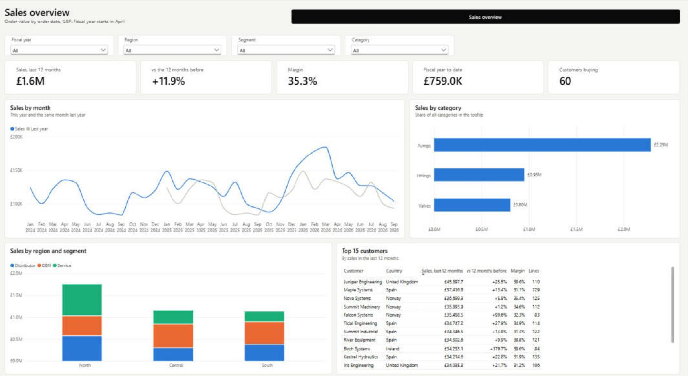

# Acme Parts sample

A fictional parts supplier: 6,000 order lines (CSV), 60 customers (CSV) and 32 products (Excel), January 2024 to September 2026. It is the end-to-end test for `/model-it` and `/viz-it`, and a quick way to see what they produce.



## Build it

From this folder, with Node 18+ and Power BI Desktop installed:

```
node ../../skills/model-it/scripts/new-project.js . "Acme Sales"
node _model/build.js
node _viz/build.js
```

Open `Acme Sales.pbip` in Power BI Desktop and click **Refresh now** on the yellow bar. The model loads the CSV and Excel files from `data/` and the "Sales overview" page fills in.

| File | What it shows |
|---|---|
| `_model/build.js` | Three source tables (two CSV, one Excel sheet), a calendar with an April fiscal year, four relationships (one inactive, used through `USERELATIONSHIP`), and measures built from the `dax` patterns: rolling 12 months, prior year, fiscal year to date, share of category. |
| `_viz/build.js` | One report page: slicers, headline cards, a month trend against last year, category bars, a stacked region chart and a top-15 customer table. |
| `make-data.js` | Regenerates the data (seeded, so the numbers stay the same). |

Checked against the raw CSV: last 12 months £1,623,838, +11.9% on the 12 months before, fiscal year to date £759,042, 60 customers.
